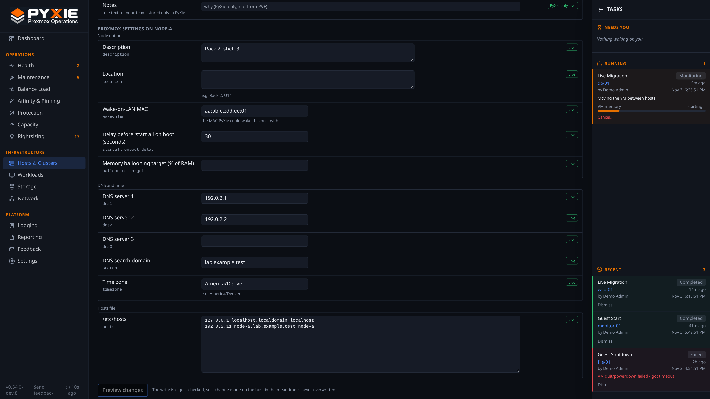

# Change a host's settings and network from PyXie (the host's Config tab)

Open **Hosts & Clusters**, click a host, then **Config**. Every change is previewed, approved and audited like any other write, and each is a Proxmox change that needs **Write to Proxmox** switched on (**Settings**). PyXie needs the host's Proxmox account to have `Sys.Modify`.

## Host settings

| Group | What you can change |
|---|---|
| **Node options** | Description, location, Wake-on-LAN MAC, delay before "start all on boot" (0-300 s), memory ballooning target (0-100 % of RAM) |
| **DNS and time** | DNS servers 1 to 3, DNS search domain (required), time zone |
| **Hosts file** | The host's `/etc/hosts` |

How it works: you edit the form, press **Preview**, and PyXie shows each setting as *old value, new value*. Values are checked against Proxmox's own limits before a preview exists, so a bad value is a form error and not a failed task. After you approve, PyXie writes the change, reads the setting back and compares (a trailing newline Proxmox adds does not count as a difference). The hosts file has an extra check: it must still contain the `localhost` line and the host's own name, because a broken hosts file can break a Proxmox host.

## Network interfaces: stage, reload, discard

Proxmox keeps a two-step model for network changes, and PyXie keeps it:

1. **Stage** writes `/etc/network/interfaces.new` only. The running network is not touched. You can stage several interfaces and review them.
2. **Reload** applies the staged file with ifupdown2. **Discard** deletes the staged file instead.

Editable on a bridge, bond or VLAN interface: address (CIDR), gateway, MTU, comment, start at boot; on a bridge: ports, VLAN aware, allowed VLANs; on a bond: slaves, mode, transmit hash policy, primary slave. Each step is its own preview and approval.

Safety rules:

- **An edit that would move the address PyXie uses to reach the host is refused outright.** Proxmox cannot roll a reload back, so that is a console job.
- A change to a link that carries PyXie's traffic or the cluster's needs the **host's name typed** to confirm the reload.
- An edit that would leave the interface holding PyXie's address without **Start at boot** is refused.
- PyXie reads the staged file back after staging and only moves on when it matches what you asked for.

## What was tested

Staging and discarding were exercised on a real host. **The reload step is covered by automated tests only**: a real network reload can cut a host's network, so it was deliberately not run on a lab host. Do the first reload on a host you can reach at its console.

## Related

- Guest (VM and container) settings: [guest-config.md](guest-config.md).
- The maintenance wrapper that some actions need: [add-wrapper.md](add-wrapper.md).
