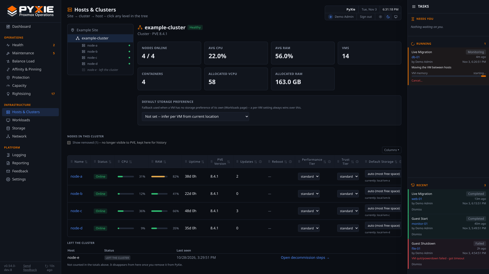
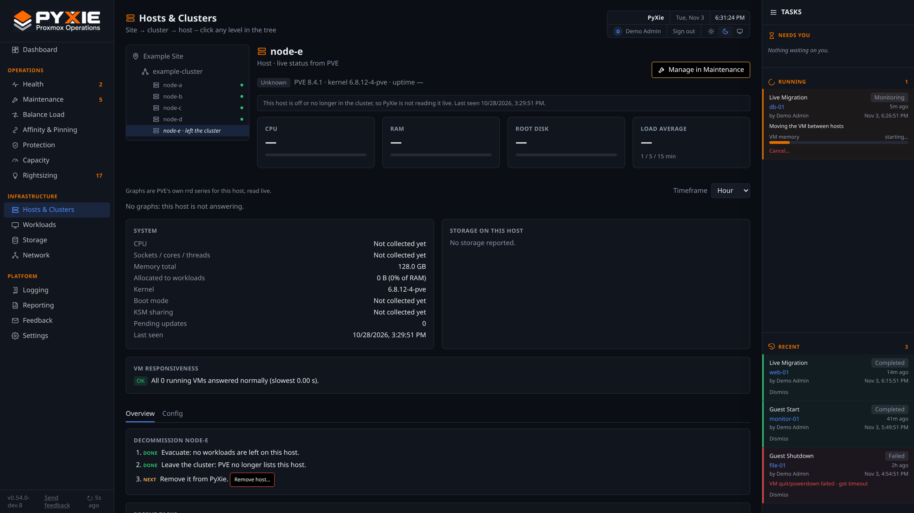

# Host lifecycle: empty, restart, shut down, retire

The actions on a host's page, in the order you usually need them. All of them are previews you approve in the [Tasks panel](tasks-panel.md); none runs by itself.

## 1. Empty a host: Evacuate / Maint Mode

**Evacuate / Maint Mode** puts a host in maintenance mode and moves its running guests to other hosts, live, so you can work on it. The preview lists every guest and where it goes; you can change a destination before approving.

- **Stopped guests** on shared storage stay where they are (nothing needs to move for maintenance); they are listed with an option to move them too (an offline move that only changes the configuration, nothing is copied).
- **How many move at once** follows the limits in [workers.md](workers.md) (default: one at a time). With limits of 2/2/1 an evacuation moves two guests together, never two into the same host.
- **Cancel** stops the move running now and starts nothing further; guests already moved stay where they are.
- **Exit Maintenance Mode** takes the flag off. It does **not** move guests back: use Balance Load or move them yourself.
- While a host is in maintenance mode PyXie does not pick it as a destination, and a host with moves in flight cannot be put into maintenance mode by another task.

**Avoid as an automatic destination** (host page, **Config** tab) keeps Balance Load and evacuations from choosing that host, for example while you are about to upgrade or drain it. A person can still choose it by hand in a plan.

## 2. Restart or shut down a host

On the host's page, **Restart…** and **Shut Down…** are available only when:

- the host is **in maintenance mode** with **nothing running on it**,
- the cluster stays quorate without it.

You confirm by **typing the host's name**. Restart and Shut Down need Proxmox changes enabled. **Restart** waits for the host to come back, checks it is online, reachable and in quorum, and reports the kernel and uptime (a typical lab host takes about a minute). **Shut Down** completes when the host is confirmed offline; PyXie cannot power a host back on, and says so. There is no automatic power cycle: a host that does not come back stops the task and asks you to act.

## 3. A host that has left the cluster

When Proxmox no longer lists a host (you ran `pvecm delnode`, or it was powered off and removed), PyXie keeps it visible until you finish retiring it:

- **Hosts & Clusters**: a greyed row "name · left the cluster" in the tree, and a **Left the cluster** table under the nodes with the last-seen time and **Open decommission steps**. It is not counted in the node totals.
- **Maintenance tab**: a **Left the cluster** badge and **Remove from PyXie…**; it gets no maintenance actions.
- The **maintenance flag** is cleared automatically (with an audit entry), since a host that left cannot be in maintenance.
- The host's page shows "This host is off or no longer in the cluster, so PyXie is not reading it live", and a **Decommission** checklist: guests moved off, left the cluster, **Remove host…**.

**Remove host…** (administrators) asks you to confirm and lists what is dropped (the entry in Hosts & Clusters and the node totals, the pinned SSH key and wrapper record, its rows in the Maintenance and Credentials lists, its local storage entries) and what is kept (audit log, past tasks, findings and notification history). It forgets the host in PyXie only: it never touches the host or the cluster, and a host Proxmox still lists can never be removed this way. If Proxmox lists the host again later, PyXie brings it back by itself.

## Related

- Patching a host: [patching-a-node.md](patching-a-node.md). Installing the wrapper: [add-wrapper.md](add-wrapper.md).
- Stuck guest locks that block moves: [stale-locks.md](stale-locks.md).
