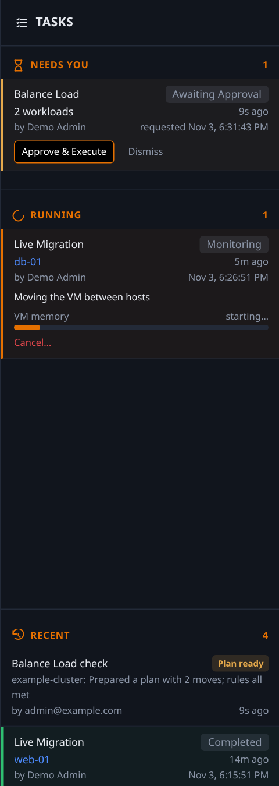

# The Tasks panel: watching, approving and cancelling what PyXie does

Everything PyXie changes in Proxmox is a **task**: a preview you approve, then a run. The **Tasks panel** on the right of every page is the one place to see them. (It is always open on a wide window; on a narrow window it slides over the page from the **Tasks** tab on the right edge, which also shows how many tasks are active.)

## The three sections

| Section | What is in it |
|---|---|
| **Needs You** | Previews waiting for your approval. **Approve & Execute** runs one. **Dismiss** rejects it: the preview is cancelled and its locks are released, so it can never be approved by accident later. |
| **Running** | Tasks in progress, with a progress bar and the guest or host they are working on. A bigger run (an evacuation, a Balance Load plan) shows its guests underneath, including the ones still queued. A task waiting for a busy guest or host says **Waiting for** and what it waits for. |
| **Recent** | The 3 newest finished tasks and Balance Load checks. **Show all** opens the full scrolling history (up to 7 days, 100 items); **Show fewer** folds it back. |

Each row has a coloured edge: **orange** running, **amber** needs you, **red** failed, **green** completed, **grey** cancelled or blocked. A failed task keeps its red row, with the reason, until you **Dismiss** it.

## Cancel

A running row has **Cancel…** (administrators only) for the task types that can be stopped safely: a live migration, a disk move, an evacuation, a maintenance run and a Balance Load plan. You are asked to confirm, and the text says what happens:

- *A migration:* the guest keeps running on its source host. PyXie stops the Proxmox task and checks where the guest is.
- *A disk move:* the original disk was never touched and the guest keeps running; PyXie stops the Proxmox task and checks where the disk is.
- *A run of several moves:* the move running now is stopped and nothing further starts. Guests already moved stay where they are.

A cancelled task ends as **Cancelled** with a note such as "tvm-e stayed on st-pve105". Other task types (shutdown, snapshot, resize, setting edits) are short and have no Cancel.

## The bar at the top of the page

A thin bar under the header appears **only for things that need you**: an amber **Waiting for approval** row (with **Review**) and a red **failed** row (with **Open task** and **Dismiss**, shown for 30 minutes). Everything else lives in the panel. The bar stops short of the user box on the right so nothing is covered. Each person can hide it in **Profile**; the panel is unaffected.

## Related

- How tasks are queued, how many run at the same time and what happens when a guest is busy: [workers.md](workers.md).
- Emptying a host and the other host actions: [host-lifecycle.md](host-lifecycle.md).
